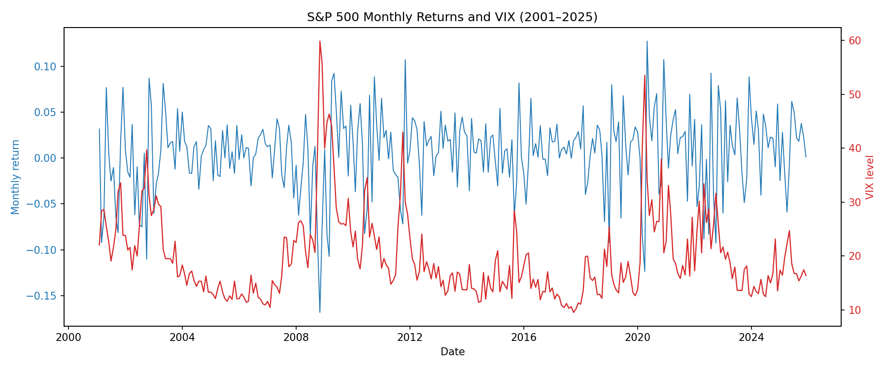
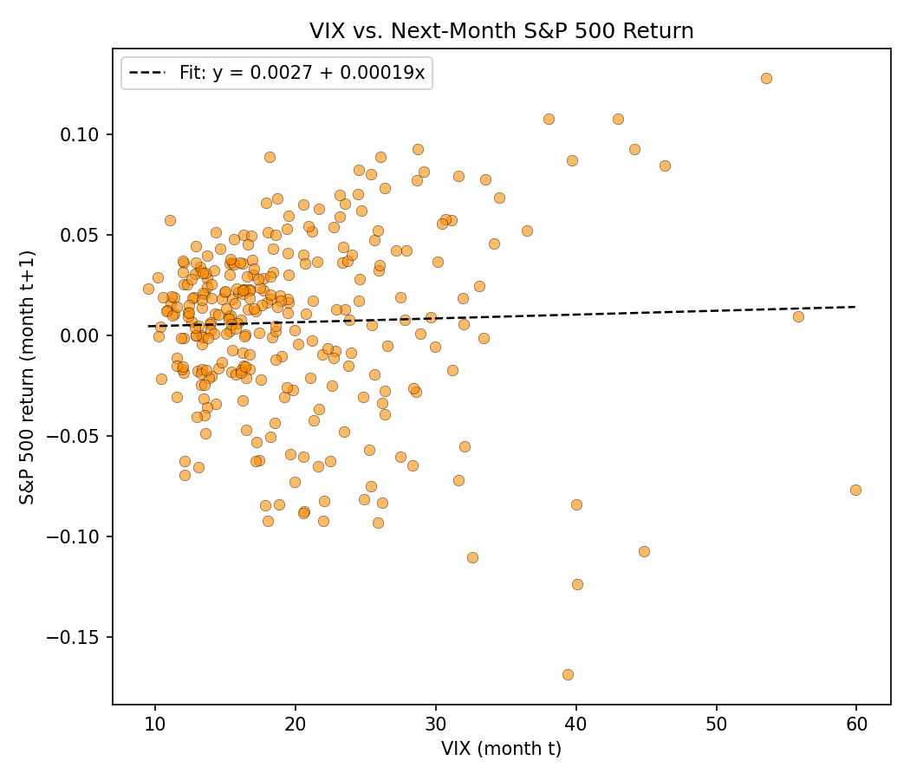
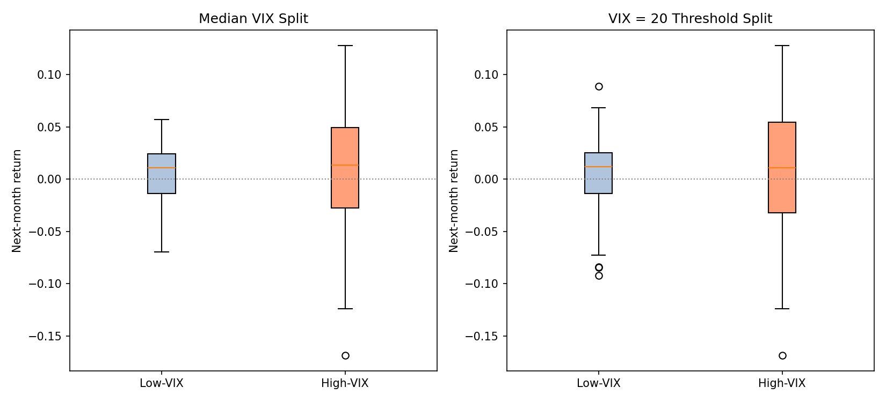
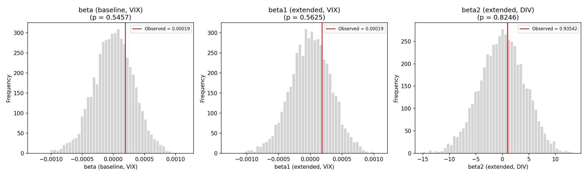

# Does Investor Fear Predict Stock Returns? Evidence from VIX and the S&P 500 (2001–2025)

**Course:** DS607, Master of Data Science in Economics (MDSE)

**Student:** Tan Kok Yong (Student ID 01426300)

**Submission Date:** Nov 2026

---

## 1. Motivation and Background

Standard finance theory holds that stock prices already reflect all available information, so investor "mood" shouldn't predict future returns. The behavioral finance literature contrasts this view: irrational sentiment — waves of excessive optimism or pessimism — can persist and move prices away from fundamentals, since limits to arbitrage prevent informed traders from correcting the mispricing immediately.

Schmeling (2009, *Journal of Empirical Finance*) tests this using consumer confidence across 18 countries and finds a significant negative relationship — high optimism predicts lower future returns. This project asks whether the same pattern holds using a market-implied fear gauge instead of a survey measure: the VIX, derived from S&P 500 option prices.

Since VIX moves opposite to confidence, the literature-grounded prediction here is a **positive** relationship between lagged VIX and subsequent returns — the mirror image of Schmeling's result.

## 2. Research Question

**Does the VIX (as a proxy for investor fear/sentiment) predict subsequent S&P 500 returns, and does this relationship differ between high-VIX and low-VIX periods?**

Sub-questions addressed:
- Is there a statistically significant relationship between lagged VIX and next-month S&P 500 returns?
- Does adding dividend yield as a control change that relationship?
- Does the strength of this relationship differ between calm and turbulent (e.g. COVID-era) periods?
- Are standard OLS-based confidence intervals reliable here, given that VIX is highly persistent and returns are known to be non-normal?

## 3. Data Sources and Access

| Variable | Description | Source | Frequency | Coverage |
|---|---|---|---|---|
| S&P 500 return | `MthPrcRet`, `MthTotRet` — monthly price and total return | WRDS, CRSP "Monthly Index and Portfolios on S&P 500" | Monthly | Jan 2001 – Dec 2025 |
| VIX | CBOE Volatility Index, daily close | WRDS (CBOE/index database) | Daily → resampled to month-end | Jan 2001 – Dec 2025 |
| Dividend yield | Constructed as `MthTotRet − MthPrcRet` | Derived from the CRSP file above (no separate source) | Monthly | Jan 2001 – Dec 2025 |

**⚠️ Data access note:** The raw CRSP and CBOE VIX data are sourced via WRDS institutional access and **cannot be redistributed** in this public repository per WRDS's terms of use. The `data/raw/` folder is therefore not tracked in this repo (see `.gitignore`).

To reproduce this analysis, you will need your own WRDS subscription (available through most university library systems) to pull:
- `SP_500_Index-2001-2025.csv` — from CRSP's "Monthly Index and Portfolios on S&P 500" table, fields: `YYYYMM`, `MthCalDt`, `MthPrcRet`, `MthTotRet`, for INDNO corresponding to the S&P 500, Jan 2001–Dec 2025
- `VIX-2001-2025.csv` — daily CBOE VIX close, Jan 2001–Dec 2025

Once obtained, place both files in `data/raw/` before running the notebook (see Setup below).

**Known data limitations:**
- The VIX daily series has 4 missing values, none falling on a month-end date; these are forward-filled and documented in the notebook, with no effect on the resampled monthly series actually used in the analysis.
- `MthPrcRet` (price return) excludes dividends; dividend yield is added as a control variable (Section 6) to partially address this, rather than switching the dependent variable to total return.

## 4. Repository Structure

```
project-repository/
|-- README.md                    # This file
|-- AI_USAGE.md                  # AI use disclosure
|-- CONTRIBUTIONS.md             # Contribution notes (individual project)
|-- requirements.txt             # Python dependencies
|-- .gitignore                   # Excludes data/raw/*, caches, credentials, etc.
|-- data/
|   |-- raw/                     # Original CRSP/VIX CSVs — not tracked (see Data Access above);
|   |                            #   .gitkeep placeholder keeps the empty folder visible in the repo
|   |-- interim/
|   |   |-- vix_month_end.csv    # VIX resampled to month-end, pre-merge
|   |-- processed/
|   |   |-- merged_monthly.csv   # Analysis-ready dataset (299 obs after lagging)
|-- notebooks/
|   |-- main_analysis.ipynb      # Full analysis notebook (Steps 1–7, calls into src/)
|-- src/
|   |-- __init__.py              # Marks src/ as an importable package
|   |-- data_prep.py             # Step 1 — load, clean, merge, lag, regime indicators
|   |-- descriptive.py           # Step 2 — plots, summary stats, VIF check
|   |-- models.py                # Steps 3–4 — baseline and extended regressions (OLS + HAC)
|   |-- bootstrap.py             # Step 5 — moving block bootstrap
|   |-- regime.py                # Step 6 — high/low-VIX regime comparison (Welch's t-test)
|   |-- nonparametric.py         # Step 7 — permutation test
|-- outputs/
|   |-- figures/
|   |   |-- timeseries_returns_vix.png
|   |   |-- returns_histogram_qqplot.png
|   |   |-- vix_vs_next_return_scatter.png
|   |   |-- bootstrap_distribution.png
|   |   |-- regime_comparison_boxplot.png
|   |   |-- permutation_distribution.png
|   |-- tables/
|   |   |-- summary_statistics.csv
|   |   |-- vif_table.csv
|   |   |-- baseline_regression.csv
|   |   |-- baseline_vs_extended.csv
|   |   |-- bootstrap_ci_comparison.csv
|   |   |-- regime_comparison.csv
|   |   |-- permutation_test.csv
|   |-- presentation/
|   |   |-- DS607_GP_01426300_slides.pdf
```

## 5. Setup and Execution Instructions

**Requirements:** Python 3.10+ and the packages in `requirements.txt`.

```bash
git clone <this-repo-url>
cd project-repository
pip install -r requirements.txt
```

**Data:** place your own `SP_500_Index-2001-2025.csv` and `VIX-2001-2025.csv` (see Section 3 — Data Access) into `data/raw/`.

**Run the analysis:**
1. Open `notebooks/main_analysis.ipynb` in Jupyter, VS Code, or Google Colab (after cloning the repo).
2. Run all cells top to bottom. No path edits are required — `PROJECT_ROOT` is resolved automatically relative to the notebook's location:
   ```python
   PROJECT_ROOT = os.path.abspath(os.path.join(os.getcwd(), ".."))
   ```
   This assumes the notebook is run from within `notebooks/` (the default working directory when opened via Jupyter, VS Code, or Colab-after-clone), with `data/` and `outputs/` as sibling folders — i.e. the structure above, unmodified.
3. All intermediate and final files write automatically to `data/interim/`, `data/processed/`, `outputs/figures/`, and `outputs/tables/`.

**Reproducibility:** random seeds are fixed throughout (`seed=42` for both the block bootstrap and the permutation test), so re-running the notebook reproduces identical results.

## 6. Summary of Methods

The notebook proceeds through seven steps:

1. **Data preparation** — clean and merge CRSP/VIX data, construct dividend yield (`DIVₜ = MthTotRetₜ − MthPrcRetₜ`), resample VIX to month-end, lag VIX/DIV by one month against next-month return `Rₜ₊₁` (avoiding contemporaneous feedback, since VIX moves mechanically with same-month price moves), and build High/Low-VIX regime indicators (median split and a VIX = 20 threshold).
2. **Descriptive analysis** — time series and scatter plots, return histogram/Q-Q plot with a Shapiro-Wilk normality test, summary statistics, and a VIF check between VIX and dividend yield (rule of thumb: VIF > 5 signals concerning multicollinearity).
3. **Baseline regression** — `Rₜ₊₁ = α + β·VIXₜ + εₜ`, estimated via `statsmodels.OLS`, tested against H₀: β = 0.
4. **Extended regression** — `Rₜ₊₁ = α + β₁·VIXₜ + β₂·DIVₜ + εₜ`, with both ordinary and HAC (Newey-West) standard errors reported side by side, individual and joint (F-test) hypothesis tests, and adjusted R² used for model comparison (not R², which would mechanically favor the model with more predictors).
5. **Block-bootstrap inference** — a moving block bootstrap (following Schmeling, 2009; block length ≈ n^(1/3), 5,000 replications) resamples full rows `(VIXₜ, DIVₜ, Rₜ₊₁)` jointly to preserve time-series dependence that an i.i.d. bootstrap would destroy, producing bootstrap confidence intervals compared against the OLS/HAC intervals.
6. **High- vs. low-VIX regime comparison** — Welch's two-sample t-test (chosen over a standard pooled-variance t-test since high/low-VIX months plausibly have unequal variances) comparing mean next-month returns across regimes, with a subgroup-size adequacy check.
7. **Nonparametric permutation test** — since Mann-Whitney is not covered in this course, a permutation test was used instead: `next_month_return` is shuffled 5,000 times and each model refit, building an assumption-free empirical null distribution for β (baseline) and β₁, β₂ (extended). This permutes the response only, so VIX's own persistence does not bias the test.

## 7. Key Results

| Test | Result |
|---|---|
| Baseline regression (β, VIX) | β = 0.000191, t = 0.599, p = 0.549, R² = 0.0012 → fail to reject H₀: β = 0 |
| Extended regression (β₁, β₂) | β₁ (VIX) p = 0.563, β₂ (DIV) p = 0.827; adjusted R² = −0.0054; joint F-test p = 0.817 → fail to reject H₀ for either coefficient or jointly |
| Block bootstrap | 95% CIs for β₁ and β₂ both contain 0, consistent with OLS and HAC intervals |
| Regime comparison (median / VIX=20 split) | Mean next-month returns statistically indistinguishable across high-/low-VIX regimes (p = 0.978 / p = 0.924); high-VIX months show visibly wider return dispersion despite similar means |
| Permutation test | p ≈ 0.55 (baseline β), 0.56 (β₁), 0.82 (β₂) — closely tracks OLS p-values |

**VIX and S&P 500 returns, 2001–2025** — the GFC (2008) and COVID (2020) spikes stand out clearly, giving the high/low-VIX regime split meaningful coverage of turbulent periods beyond COVID alone:



**VIX vs. next-month S&P 500 return** — a mild positive slope, consistent with the mirror-image-of-Schmeling prediction, though not statistically significant (see baseline regression above):



**High- vs. low-VIX regime comparison** — mean returns are nearly identical across regimes, but high-VIX months show visibly wider dispersion (larger box, wider whiskers), suggesting VIX predicts next-month return *volatility* more than *direction*:



**Permutation test null distributions** — the observed β for each coefficient (red line) sits well within the bulk of the assumption-free permutation null distribution, reinforcing the non-significant OLS/HAC/bootstrap findings from a fifth, independent angle:



See `outputs/tables/` for full regression tables and `outputs/figures/` for all plots (including the Q-Q plot and bootstrap distribution not shown above).

**Overall finding:** across five different inference approaches (OLS, HAC, block bootstrap, Welch's t-test, and permutation), VIX does **not** show a statistically significant predictive relationship with next-month S&P 500 returns over 2001–2025, either alone or with dividend yield as a control. This consistency across methods with very different assumptions is itself a meaningful result: the null finding is not an artifact of any single method's distributional assumptions. Interestingly, while VIX does not predict return *direction*, high-VIX months show visibly greater return *dispersion*, suggesting VIX may better capture next-month volatility than next-month direction.

## 8. Limitations

- **Predictive, not causal:** VIX (fear/sentiment) is not randomly assigned, so any relationship found should be read as predictive/associational, not causal.
- **COVID as a structural break:** the largest fear spike in the sample (March–April 2020) coincides with an unprecedented policy response, so any relationship found may be partly attributable to policy rather than pure sentiment dynamics.
- **VIX as an imperfect sentiment proxy:** VIX is mechanically a volatility measure, not a pure behavioral sentiment measure, so any significant β may reflect a volatility risk premium rather than purely behavioral overreaction.
- **Remaining omitted variables:** lagged market returns, realized volatility, and interest-rate spreads (all suggested during proposal feedback) are not yet included as controls; adding them is a stretch goal for future iterations.


## 9. Acknowledgements

This project was completed as part of DS607 (Master of Data Science in Economics) individually, under an approved part-time-student exception in place of the standard group format. See `AI_USAGE.md` for generative AI usage disclosure and `CONTRIBUTIONS.md` for a statement of individual work.

